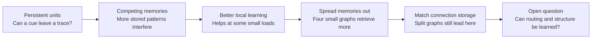

# Murmur: the story so far

This is a visual map of the research questions, not a claim that we have built a language model. Each step tests a different synthetic task; its results are not a common leaderboard.



## One experiment in pictures

The latest task asks each system to fill in a missing fourth symbol from a noisy prefix. The complete sequences were already shown during training.

```text
Observed prefix:    0 → 2 → 1 → ?
                              ↓
                    recover the stored symbol
```

Using the Storkey-style rule at 20% prefix-bit corruption:

```text
Single 256-unit graph       █████████░░░░░░░░░░░   46%
Four routed 128-unit graphs ███████████████░░░░░   76%
Direct lookup               ████████████████████   98%
```

The single graph and four graphs have about the same connection-array storage in this implementation. The four-graph system also has more units and an external router that searches stored prefixes. A sensitivity test gave the single graph different, independent codes; it reached 49%, still below the split setup in this sample. These bars summarize 20 seeds, not a guarantee or a test of unseen sequences. See [the full protocol and results](EXPERIMENTS.md#four-small-graphs-versus-one-graph-with-matched-connection-storage).

The progression shows a promising effect of distributing this particular memory task—and the gap still to close before the network can decide for itself how to organize, route, and learn over time.
